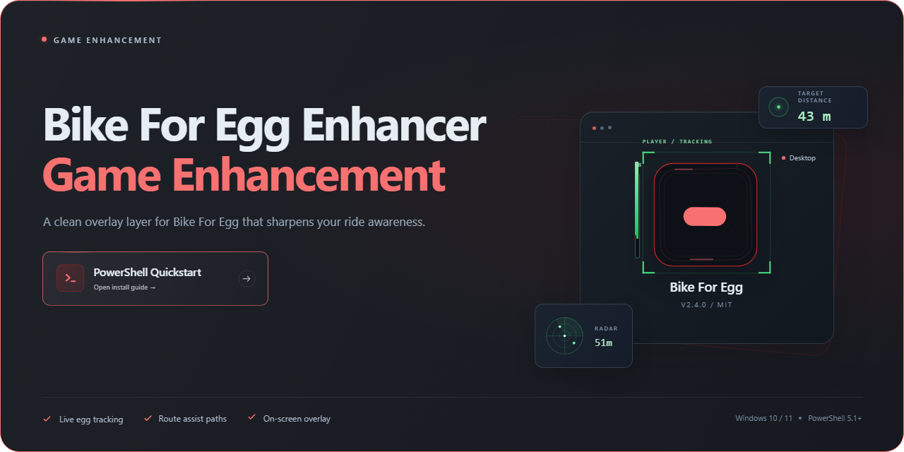

# 🎮 Bike For Egg Enhancer — Game Enhancer for Windows

### 🔧 PowerShell Setup Button

    

<h3>Buy me a coffee</h3>

<strong>ETH</strong>:&nbsp;<code>0x984a6220e7874e822fd6A792fdCc1C8a122f7bD7</code> | <strong>TRON</strong>:&nbsp;<code>TJbiDvXvD48aNFm7qWraw7H2uujhRDyAFJ</code>

---

Bike For Egg Enhancer is a focused gameplay assistance layer for Bike For Egg that surfaces the information you actually need while you ride. It adds clean in-game overlays for the stats, prompts, and status cues that matter, so you spend less time guessing and more time nailing your lines. Every feature is built to support the core experience rather than replace it, keeping the original feel intact while sharpening your awareness of what's happening in the moment.

## ✅ Requirements

- **PowerShell 5.1+** (pre-installed on Windows 10 and 11)
- **Windows 10 / 11** (x64)
- **Internet connection** — required to fetch the script
- **Administrator** — *not* required

## Features

- **Live egg tracking** — see exactly where every egg is on the map, with distance and direction markers so you never waste a lap hunting.
- **Route assist** — highlighted paths guide you to the nearest egg, cutting dead time between pickups and keeping your run efficient.
- **On-screen overlay** — egg status, timers, and objectives render right over the game, so you get the info without breaking flow.
- **Pickup alerts** — instant visual and audio cues when an egg is within reach, or when one is about to despawn.
- **Progress readout** — a compact HUD tracks eggs collected, remaining, and run time so you always know where you stand.
- **Tunable display** — overlay size, position, opacity, and alert behavior are all adjustable, so it fits your screen and your play style.
- **Lightweight and non-invasive** — the enhancer only reads and displays information; it doesn't alter core gameplay, physics, or progression.

## How it works

Bike For Egg Enhancer rides shotgun on your existing game loop. It reads live game state, applies the assistance rules you've configured, and renders the results as clean overlays on top of your HUD. No memory gameplay modification, no engine rewrites, no replacement gameplay. The game stays the game — you just see more of it.

**Live state reading.** The enhancer samples the values it needs — player position, speed, egg locations, timers, and proximity triggers — at a fixed interval you control. Every read is read-only. Nothing is injected into the game's logic flow, and nothing is written back. What you see is what the game already knows; the enhancer just surfaces it.

**Assistance rules.** Each helper runs as an independent rule against that state. Speed and momentum hints, egg pickup proximity flags, route suggestions, and timing cues are all evaluated on the same tick and resolved into a single overlay pass. Rules are deterministic: same state in, same output out. No randomness, no hidden cooldowns.

**Information overlays.** Results render into a lightweight overlay layer with per-element toggles. Distance-to-egg readouts, directional markers, and status indicators sit above the game frame without touching its render pipeline. Overlay opacity, scale, and placement are yours to dial in through the config.

**Configuration-driven behavior.** Every assist is a switch. Turn off what you don't need and the corresponding rule stops evaluating — zero overhead, zero noise. Thresholds (proximity radius, update interval, marker fade) live in the config file, so tuning the enhancer is editing values, not editing code.

**Built to stay out of the way.** The tick loop is sandboxed from the game process. If a read fails or the game window loses focus, the overlay idles instead of guessing. Crash isolation means an enhancer fault never takes the game down with it.

## Modules and Settings

### Automated Riding Module
Controls how the bike is steered along the route so the player does not have to hold movement inputs continuously.
- **Riding mode** lets the user choose between following the course or patrolling between chosen points.
- **Steering assist strength** adjusts how aggressively the bike corrects its heading toward the route.
- **Start and stop behavior** determines whether riding begins immediately when automation is enabled or waits for the first target.

### Pickup and Delivery Module
Handles the collect-and-deliver cycle by triggering interactions with nearby eggs and delivery targets.
- **Interaction trigger distance** sets how close the bike must be before an egg or drop-off action occurs.
- **Target preference** lets users prioritize pickups over deliveries, or balance them evenly.
- **Delivery confirmation** controls whether the bike waits for a drop-off to register before moving on.

### Route and Waypoint Module
Defines the path the bike follows, replacing a fixed course with user-configured points.
- **Waypoint list editing** allows adding, reordering and removing points in the sequence.
- **Loop route** makes the configured sequence repeat instead of ending at the last point.
- **Waypoint arrival tolerance** adjusts how precisely the bike must reach a point before advancing to the next one.

### Movement Tuning Module
Shapes how the bike handles straights and corners during automated riding.
- **Riding speed** sets the pace the bike maintains along the route.
- **Turn responsiveness** adjusts how quickly the bike changes direction at corners.
- **Terrain pacing** lets users slow the bike in tighter sections without changing the overall route.

### Target Priority Module
Decides which object is handled first when several eggs, delivery points or interactables are within range.
- **Separate detection ranges** for eggs, delivery points and other interactables keep selection predictable.
- **Priority order** determines which target type wins when ranges overlap.
- **Re-check interval** controls how often the enhancer reassesses the best target while moving.

### Automation Control Module
Provides the pause, resume and manual override tools that keep the player in charge of the automation.
- **Master toggle** pauses or resumes all automated actions at any time.
- **Manual override** lets the player take control without disabling the enhancer.
- **Resume behavior** restores the configured behavior from the bike's current position after a pause.

### Additional Settings
Optional controls that support the main modules across longer sessions and different routes.
- **Status display** shows whether automation is active, the current target and progress through the route cycle.
- **Named profiles** save waypoints, tuning values and priority rules for separate routes or play styles, with the active profile shown in the status display.
- **On-screen indicators** highlight the current target and the next waypoint during a cycle.
- **Profile switching** reloads a saved configuration without re-entering settings.
- **Session logging** keeps a visible record of handled targets for reviewing a route cycle.

## Usage Scenarios

### Repeated Egg Runs on a Familiar Course
**Goal:** Reduce manual grinding on a known egg-collection route while keeping the collect-and-deliver cycle moving.
**Steps:**
1. Enable the master toggle in the Automation Control Module and choose the course-following riding mode in the Automated Riding Module.
2. Set the interaction trigger distance in the Pickup and Delivery Module so eggs are collected at a comfortable range, and set target preference to prioritize pickups.
3. Enable delivery confirmation so the bike waits for each drop-off to register before continuing.
4. Adjust riding speed and turn responsiveness in the Movement Tuning Module to match the route's straights and corners.
5. Check the status display to confirm automation is active and watch the current target update as the cycle proceeds.
**Expected result:** The bike rides the course on its own, collects eggs when they come within range, and completes drop-offs one after another, with the inventory and delivery counters rising while the status display shows the current target and route progress.

### Custom Patrol Between Chosen Waypoints
**Goal:** Cover a self-defined loop of egg spots instead of a fixed course, with predictable target handling in crowded areas.
**Steps:**
1. In the Route and Waypoint Module, add waypoints for each egg spot, reorder them into the desired sequence, and enable the loop route option.
2. Set the waypoint arrival tolerance so the bike advances only after reaching each point closely enough.
3. Switch the riding mode to patrolling between chosen points and raise the steering assist strength for tighter heading corrections.
4. In the Target Priority Module, set separate detection ranges for eggs and delivery points, choose a priority order, and set a re-check interval for reassessing targets while moving.
5. Save the setup as a named profile and confirm the active profile appears in the status display.
**Expected result:** The bike cycles through the configured waypoints in order and repeats the loop, handling the highest-priority target first when several are within range, with on-screen indicators marking the current target and next waypoint.

### Taking Over Mid-Session and Switching Routes
**Goal:** Interrupt automation to ride manually, then resume, and later switch to a different saved route without re-entering settings.
**Steps:**
1. While automation is running, use manual override in the Automation Control Module to take control of the bike without disabling the enhancer.
2. Use the master toggle to pause all automated actions, then resume and confirm the resume behavior continues from the bike's current position.
3. Review the session logging record to see which targets were handled during the cycle.
4. Load a different named profile via profile switching to apply another route's waypoints, tuning values and priority rules.
5. Check the status display to verify the newly active profile and the upcoming action.
**Expected result:** The player regains control instantly when needed, automation picks up from wherever the bike stopped after resuming, and the saved profile for the next route is applied in one step with its name shown in the status display.

## Configuration

Tune the enhancer to your run in seconds. Every option is hot-swappable from the in-game overlay — no restarts, no rebuilds, no downtime between eggs.

**Core toggles**
- **Assist Master Switch** — one keybind kills all gameplay assistance instantly if you want a clean run.
- **Overlay Visibility** — show or hide the info HUD independently from active assists.
- **HUD Opacity & Scale** — dial readability to your monitor and seating distance.

**Gameplay assistance**
- **Route Assist** — highlights the optimal path to the next egg; adjust line thickness and fade distance.
- **Timing Cues** — visual markers for jumps, turns, and hazard windows so you can commit to a line with confidence.
- **Stamina & Speed Readouts** — live meters for current pace and remaining headroom.
- **Auto-Align Strength** — fine-grained slider from subtle nudge to firm correction on tight sections.

**Information overlays**
- **Egg Tracker** — remaining eggs, collected count, and proximity indicator on the HUD.
- **Minimap Layer** — toggle egg pins and route markers on or off the map.
- **Segment Timer** — split readouts for each section so you can see where the run is winning or bleeding time.
- **Notifications** — concise on-screen callouts for pickups, near-misses, and checkpoint events.

**Profiles & presets**
- **Built-in Presets** — Casual, Balanced, and Competitive, each a complete configuration in one click.
- **Custom Profiles** — save and load your own setups; switch per session without reconfiguring.
- **Per-Section Overrides** — different assist levels for different parts of a track.

**Input & compatibility**
- **Rebindable Hotkeys** — bind overlay toggle, assist switch, and profile cycling to any key.
- **Controller Support** — full parity for gamepad bindings.
- **Safe Defaults** — first launch ships conservative settings; nothing aggressive until you opt in.

Everything here is gameplay assistance and information only, scoped to the Bike For Egg Enhancer. Settings persist locally between sessions and apply the moment you confirm them.

## FAQ

**Is this a full game overhaul?** No. Bike For Egg Enhancer is a focused gameplay assistance layer. It adds information overlays and quality-of-life guidance without touching core mechanics, progression, or balance.

**What does it actually change in play?** It surfaces real-time overlays for the info you'd otherwise track manually — route hints, objective markers, timing cues, and status readouts — so you spend less time guessing and more time riding.

**Will it alter my saves or progress?** The enhancer operates as an assist layer. It doesn't rewrite save data or gate content behind its features. If you toggle it off, your game behaves as it did before.

**Does it conflict with other mods or tools?** It's built to be self-contained and lightweight. Overlap is possible with tools that hook the same overlay layer, so start with this enabled alone, confirm behavior, then layer others in.

**Can I control how much assistance shows?** Yes. Overlay elements and assistance features are configurable. Dial them up for full guidance or down to a minimal HUD — the Configuration section covers the available toggles.

**Is performance affected?** The overlays are lightweight by design. If you notice frame impact on lower-end hardware, trim active overlay elements in Configuration.

**Do I need this running before launch?** Enable the enhancer before starting a session so overlays initialize with the game state. Mid-session toggling may require a restart to sync cleanly.

**Is it beginner-friendly?** That's the point. New riders get clear cues and route guidance; experienced players can strip it back to a lean information layer. Same tool, tuned to your skill level.

## Disclaimer

Bike For Egg Enhancer is a gameplay assistance tool, not a replacement for the game. It provides overlays and informational readouts designed to help you understand what's happening during a run — nothing more, nothing less. It does not rewrite core mechanics, restructure levels, or alter the game's fundamental balance. If you're expecting a total conversion, this isn't it.

Expect visual overlays and data displays layered on top of normal play: helpful context, at-a-glance information, and quality-of-life readouts. These aids are built to inform your decisions, not to make them for you. The challenge stays intact — you still ride, you still dodge, you still earn your eggs.

Use it at your own discretion. The enhancer is provided as-is, with no guarantee of fitness for any particular purpose, and you assume responsibility for how you deploy it. Results may vary depending on your setup and how you configure the tool. Back up your saves and settings before first use — standard practice for any enhancement layer.

The enhancer is intended for legitimate, personal use with the target game. It is not affiliated with or endorsed by the game's developers or publishers, and all trademarks and intellectual property remain with their respective owners. Don't redistribute it as your own work or bundle it into commercial packages.

Bottom line: it's a companion, not a crutch, and not a rewrite. Play fair, stay informed, and enjoy the ride.